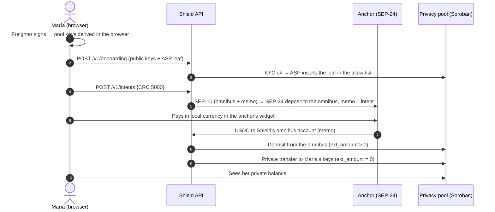

<div align="center">
  <table cellpadding="20"><tr><td align="center" bgcolor="#161616">
    
  </td></tr></table>

**KYC once, pay privately, disclose selectively.**

[](https://lendara-shield.duckdns.org/en)
[](https://lendara-shield.duckdns.org/en/docs)
[](https://stellar.org)
[](#live-on-testnet)
[](LICENSE)

</div>

---

Lendara Shield is the reference implementation of the **Shield Protocol**: a compliant privacy layer for Stellar that connects fiat on-ramps (any SEP-24 anchor) to a [Stellar Private Payments](https://developers.stellar.org/docs/build/apps/privacy) pool. Money arrives in local currency and lands as a **private balance**, and the user's address **never appears on-chain**. An auditor holding the pool's view key can still see everything.

> **Status.** Ramp mode and direct mode both run today on Stellar testnet, proved end to end with real transaction hashes (see [Proof on testnet](#proof-on-testnet)). Shield Protocol level 2 (anchors depositing natively into the pool) is a published draft, not yet implemented. Mainnet launch depends on SPP's own audit and mainnet release by Nethermind and SDF.

> ⚠️ **Testnet only.** Stellar Private Payments is a developer preview with unaudited contracts. Do not use with real funds.

## Where to read next

| If you are... | Start with |
|---|---|
| **A wallet or anchor** evaluating integration | [Developer docs](https://lendara-shield.duckdns.org/en/docs), the [API reference](https://lendara-shield.duckdns.org/api-reference.html), and [`openapi.yaml`](openapi.yaml) |
| **A security reviewer** | [Threat model](docs/threat-model.md) and [SECURITY.md](SECURITY.md) |
| **Anyone trying the demo** | The [5-minute demo](#5-minute-demo) below |

## Live on testnet

| | |
|---|---|
| Web app (English / Spanish) | <https://lendara-shield.duckdns.org/en> · <https://lendara-shield.duckdns.org/es> |
| Developer docs | <https://lendara-shield.duckdns.org/en/docs> |
| API reference (from `openapi.yaml`) | <https://lendara-shield.duckdns.org/api-reference.html> |
| API | <https://lendara-shield.duckdns.org/v1/info> · health: <https://lendara-shield.duckdns.org/health> |
| SEP-24 anchor used by ramp mode | Lendara sandbox, home domain `lendara-monorepo-fixh.vercel.app` |

Both modes are enabled: ramp (through the sandbox anchor) and direct. Use [Freighter](https://www.freighter.app/) set to **Testnet**. Direct deposits and withdraws need a trustline to the sandbox USDC (issuer `GBVIQ7QVTTJ4NLFTYYFPEKWYJWAMKDAOFYSR52ZGWJFSGTSVOO5H47B5`): the web checks it and says how to add it in Freighter. Ramp mode needs no trustline, since the user's account never receives USDC.

> Proving needs the pool's full event history and the public RPC keeps about 7 days of it. Shield runs SPP's bootnode at <https://lendara-shield.duckdns.org/bootnode> for the older events; the API, `pool-cli` and the web read from it when `SHIELD_BOOTNODE_URL` / `NEXT_PUBLIC_BOOTNODE_URL` are set. The pool was redeployed on 2026-11-06 because the first one (2026-10-26) outlived the window before the bootnode existed.

## The problem

Stellar now has privacy tools in developer preview, but privacy breaks at the **fiat edge**:

- **The ramp leaks the user.** A SEP-24 deposit pays USDC to the user's own address, with an amount and a time. Anyone can follow that address into a privacy pool and out of it.
- **A compliant pool needs an operator.** Privacy pools with an allow-list need someone to run KYC, maintain the list (the ASP), keep the auditor's view key and pay fees. Today every app would have to build that alone.

## The idea

Anchors already run KYC and already operate an omnibus account. So Shield runs the compliance work once, as the pool's ASP. It receives the anchor's payment on its **omnibus account**, deposits into the pool from there, and then **transfers privately to the user's keys**. The explorer only ever sees "the anchor paid Shield" and "Shield used the pool". The auditor's view key shows who received what.



## Two modes, one core

| | **Ramp** | **Direct** |
|---|---|---|
| For | People paying in local currency | People who already hold USDC |
| Money comes from | A SEP-24 anchor → Shield's omnibus account → pool | The user's own wallet → pool |
| User address on-chain | **Never** | Visible when depositing, and as the signer of their own transfers (until a relayer, see the threat model) |
| What Shield does | KYC/ASP, receive, deposit, transfer, audit | KYC/ASP, audit |

Ramp mode talks to the anchor **only through SEPs 1, 10 and 24**, so it works with any SEP-24 anchor, not just Lendara's sandbox. Both modes share the ASP, the pool client, the auditor and the intent state machine.

## Proof on testnet

All of these are real transactions on Stellar testnet, made from the live web app on 2026-10-26 with fresh accounts funded by friendbot.

**Ramp mode, user _dana_ (CRC 5,000 → 9.3039215 USDC).** Completed 60 s after the intent was created, 40 s after the anchor's payment, with no manual step after the anchor's widget. Dana's address appears **0 times** in the anchor payment, the deposit and the transfer (checked on Horizon: transactions, operations and effects).

| Step | Transaction |
|---|---|
| ASP adds dana's leaf to the allow-list | [`a09ac52f…`](https://stellar.expert/explorer/testnet/tx/a09ac52f164725a64985871e58b5c2d577980154dfd3a82c23927c9af187f958) |
| Anchor pays Shield's omnibus account (memo) | [`bad64913…`](https://stellar.expert/explorer/testnet/tx/bad649134d3ca5e796ba29dc8aebcbde923d573aa532e07af0faf2e1f105a358) |
| Shield deposits into the pool, `ext_amount > 0` | [`57756b31…`](https://stellar.expert/explorer/testnet/tx/57756b312631f526779dcbbf555833b72e95f0f3c0be3f153f0fc33d986026e1) |
| Private transfer to dana's keys, `ext_amount = 0` | [`86edced9…`](https://stellar.expert/explorer/testnet/tx/86edced9f47e3f8582272b74ddcc998af18fd22e5b6cdaf76f6e399dad046420) |

The private balance then shows `9.3039215 USDC` on `/en/wallet`, and `/en/audit` lists the deposit and the transfer decrypted with the Global View Key.

**Direct mode from the browser, user _kira_.** The real SDK in Chromium: keys are derived and Groth16 proofs generated client-side.

| Step | Transaction |
|---|---|
| Onboarding (allow-list) | [`325b3073…`](https://stellar.expert/explorer/testnet/tx/325b3073396df98e2aff2fdfb9cda78784eed743add81ce98a43fe891799bc0c) |
| Deposit 2 USDC (kira's address is visible, by design) | [`af38931b…`](https://stellar.expert/explorer/testnet/tx/af38931b4f4e6d6350bebda0cb800dbe48dc40e602d5e663e76e4bbb8285df9c) |
| Private transfer of 0.5 USDC to _leo_, `ext_amount = 0` | [`84c898a0…`](https://stellar.expert/explorer/testnet/tx/84c898a0ce46c0005a1eb476a5e71b3e500c53949b33a96978bc3a62f5ceca41) |
| Withdraw 0.5 USDC | [`2832394e…`](https://stellar.expert/explorer/testnet/tx/2832394ecce52efbd06fbbd58e8b8cf6b27b08a9ff0e06dce229c739ea94e225) |

Kira's public USDC balance went from 9.3039215 to 7.8039215 (−2 deposited, +0.5 withdrawn).

**Re-verified on 2026-10-28** (read-only, plus one trustline on a fresh account): web, API, anchor and contracts share the same configuration, and the intake completed 5 ramp intents with no USDC left in custody. See [docs/testing/2026-10-28-testnet-verification.md](docs/testing/2026-10-28-testnet-verification.md).

**Testnet deployment** (SPP `sdk-v0.2.1`, policy `allowlist-blocklist` + `gvk-traceable`, deployed at ledger 5,591,375 on 2026-11-06; the hashes above are from the first pool, `CDD66GL3…C7OF`, deployed at ledger 5,395,126):

| Contract or account | Address |
|---|---|
| Privacy pool (USDC) | [`CAB6FI43…KR4`](https://stellar.expert/explorer/testnet/contract/CAB6FI43BVMPMAXYCLVZ7R5DYQY3IUJF3G7JMSBEXJHWO7LEUE3H4KR4) |
| USDC (SAC of the sandbox anchor's asset) | [`CAE6WLIM…R4QX`](https://stellar.expert/explorer/testnet/contract/CAE6WLIMEMDSRSZZW7H3O7DJS2DRDV5NTR2FHE53TKGJMJOHWGKSR4QX) |
| ASP allow-list (membership) | [`CCCFDS2I…CHVG`](https://stellar.expert/explorer/testnet/contract/CCCFDS2IABWNR7VEFH5F3OUGNBMNPVMD5UOA7V6V4ZCBTM3UEMRYCHVG) |
| ASP block-list (non-membership) | [`CAO3DGTQ…B53C`](https://stellar.expert/explorer/testnet/contract/CAO3DGTQTVZ2A7XVKKZDHOR7CTTPOYV4U3YLK5UDCUSQBUE6RBEVB53C) |
| Operator (pool and ASP admin) | [`GCCWXZJT…2GTE`](https://stellar.expert/explorer/testnet/account/GCCWXZJTF7XMEISC2CXLO6SWETJHE4YBBNVXSMRYOWH7RUOEN2YGGVTE) |
| Shield's omnibus account (intake) | [`GC5VXVUO…EHPQ`](https://stellar.expert/explorer/testnet/account/GC5VXVUOU6OHZVZ3KZNFK5CJNOEDQUMOOZI32VHYHYV64GBHVCPTEHPQ) |

## Architecture

```
lendara-shield/
├── apps/api/        Rust (Axum): ASP, intents, SEP-1/10/24 client, Horizon watcher,
│                    shielding worker, auditor. Ports and adapters; Postgres (sqlx).
├── apps/pool-cli/   Rust: stateless JSON CLI around the SPP SDK (prover, signing, GVK audit).
│                    The API runs it as a subprocess with an isolated environment.
├── apps/web/        Next.js, in English and Spanish: onboarding, deposit (both modes), private
│                    wallet, audit, and developer docs (/en/docs, /es/docs) with the API reference.
│                    The SPP browser SDK proves in the user's browser.
├── packages/api-types/  TypeScript types generated from openapi.yaml.
├── openapi.yaml     The API contract (source of truth).
└── docs/            Protocol draft, threat model, scenarios, SPP spike, demo script.
```

- **Why a CLI for the prover?** The SPP Rust SDK links a SQLite version that conflicts with `sqlx`. A separate stateless binary keeps the API free of it and gives the prover its own minimal environment.

### Security model

| What | How it's protected |
|---|---|
| User spending keys | Derived and kept in the user's browser only; Shield never holds them |
| Operator, omnibus and auditor keys | Three separate keys, never reused. The Global View Key reaches only the auditor's `pool-cli` process, never the browser or the shielding worker |
| Pool transactions | Proved, signed and **stored before submission**; on retry, the worker checks the stored hash first, so a deposit or transfer can never be sent twice. Tested against a fake chain under ambiguous submits, dropped and refused transactions, and RPC indexing lag. Every test asserts exactly one deposit and one transfer |
| Onboarding and intents | Require the account's own SEP-53 signature over its keys; a signed intent request is single-use (`request_id`, replay-guarded) |
| Logs | Never include view keys, notes, note secrets, or the pair "user address + amount" |

Full detail: [Threat model](docs/threat-model.md) and [SECURITY.md](SECURITY.md).

### Technology stack

| Layer | Choice | Why |
|---|---|---|
| API | Rust, Axum, Postgres (`sqlx`) | Ports and adapters; typed domain, no `unwrap`/`panic` outside tests |
| Prover | Rust, stateless CLI around the SPP SDK | SPP's SDK links a SQLite version that conflicts with `sqlx` |
| Web | Next.js, TypeScript | Onboarding, deposit, wallet and audit, in English and Spanish |
| Privacy pool | Soroban ([Stellar Private Payments](https://developers.stellar.org/docs/build/apps/privacy), by Nethermind), Groth16 on BN254 | Deployed unmodified, pinned to `sdk-v0.2.1` |
| Funding source | Any SEP-1/10/24 anchor | Validated today against Lendara's own testnet sandbox anchor |

## Run locally

Requirements: Node 24, pnpm 12, Rust stable, Docker, the [`stellar` CLI](https://developers.stellar.org/docs/tools/cli) and [Freighter](https://www.freighter.app/) set to **Testnet**.

```bash
cp .env.example .env
make install
make db-up
make setup-testnet        # funds Shield's accounts, deploys the pool and initialises the intake
                          # (idempotent); copy the variables from
                          # ~/.local/share/lendara-shield/testnet/testnet.env into .env
make build-pool-cli
make dev                  # API on :8080, web on http://localhost:3000
```

Then set `ADMIN_TOKEN` and `AUDITOR_TOKEN` in `.env` (`openssl rand -hex 32`). Ramp mode uses the public Lendara sandbox anchor by default (`RAMP_ANCHOR_HOME_DOMAIN`); leave it empty to run with direct mode only.

Checks: `make lint`, `make test` (Postgres needed), `make test-web-e2e`, and `make test-testnet` for read-only checks against testnet.

## 5-minute demo

1. **Onboard.** Open <http://localhost:3000/en/onboard> (or `/es/…` in Spanish) and connect Freighter (Testnet). Choose the KYC scenario **Approved** and click *Derive keys and register*. Freighter signs twice: once to derive your pool keys in the browser, once to prove the account is yours. Shield then adds your leaf to the allow-list. The ASP transaction appears with a link.
2. **Deposit with a ramp.** On `/en/deposit`, choose *With a ramp*, enter `CRC 5000` and continue. In the anchor's window, pay with the test card **4242 4242 4242 4242** (any future date and any CVC): it is the *Approved* outcome. Back in Shield, the timeline fills on its own: anchor paid Shield → Shield deposited into the pool → private transfer to your keys. There is a link for every step.
3. **Check the explorer.** Open the three links: your address is in none of them. The deposit shows `ext_amount > 0` from Shield's account. The transfer shows nothing but Shield's account.
4. **See your private balance.** On `/en/wallet`, the USDC is there. Only you, and the auditor, can see it.
5. **Audit.** On `/en/audit`, paste `AUDITOR_TOKEN`. The same transaction appears side by side. The explorer sees *"signed by Shield, amount hidden, recipient not visible"*; the auditor sees *"9.30 USDC to you"*.

To try direct mode, choose *From my wallet* on `/en/deposit`. Your account needs testnet USDC from the sandbox and its trustline; without the trustline the form is blocked and explains how to add it.

Try the gatekeeper too: onboard another account with **Rejected** (it never enters the allow-list) or **Blocked** (frozen by the ASP). In the anchor's widget, card **4000 0000 0000 0002** (*Rejected (KYC)*) ends the intent in `error` without touching the pool. All scenarios are listed in [docs/scenarios.md](docs/scenarios.md).

## Documentation

The web app has developer docs in English and Spanish at `/en/docs` and `/es/docs` (overview, protocol, quickstart, API, scenarios, security), plus the full API reference generated from `openapi.yaml` at `/api-reference.html`.

| Document | Description |
|---|---|
| [Shield Protocol (draft)](docs/protocol/shield-protocol.md) | Shield as middleware for any SEP-24 anchor (level 1) and native shielded deposits for anchors (level 2) |
| [Threat model](docs/threat-model.md) | What is private, from whom, and the honest limits |
| [Scenarios](docs/scenarios.md) | KYC and anchor outcomes and what Shield does with each |
| [SECURITY.md](SECURITY.md) | Security fixes applied, and how to report a vulnerability |
| [SPP spike](docs/spikes/spp.md) | What we verified about Stellar Private Payments before building |
| [Testnet verifications](docs/testing/) | Dated checks of the live deployment, the anchor and the contracts |
| [Demo video script](docs/demo-script.md) | Script for the submission's demo video |

## Team

[Lendara](https://github.com/Lendara-Org)

- **Anouk Rímola** ([LinkedIn](https://www.linkedin.com/in/anouk-r%C3%ADmola-b9915a223/))
- **María Elisa Araya** ([LinkedIn](https://www.linkedin.com/in/arayamariaelisa/))
- **Karen Giannetto** ([LinkedIn](https://www.linkedin.com/in/karen-giannetto/))

## License

[Apache-2.0](LICENSE)
