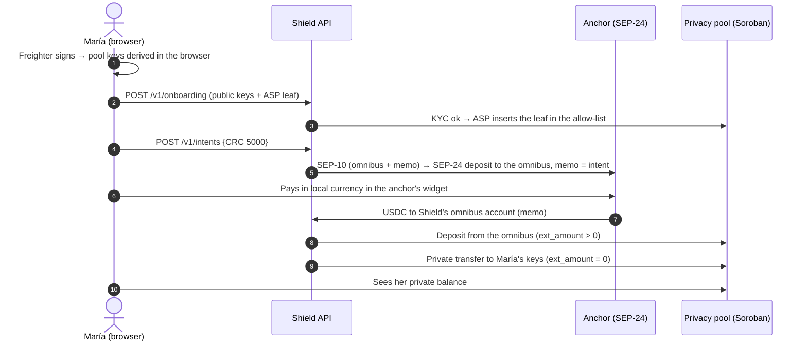

# Lendara Shield

> **KYC once, pay privately, disclose selectively.**

Lendara Shield is the reference implementation of the **Shield Protocol**: a compliant privacy layer for Stellar that connects fiat on-ramps (any SEP-24 anchor) to a [Stellar Private Payments](https://developers.stellar.org/docs/build/apps/privacy) pool. Money arrives in local currency and lands as a **private balance**, and the user's address **never appears on-chain**. An auditor holding the pool's view key can still see everything.

> ⚠️ **Testnet only.** Stellar Private Payments is a developer preview with unaudited contracts. Do not use with real funds.

Built for **HackMeridian 2026** (Genesis track).

## The problem

Stellar now has privacy tools in developer preview, but privacy breaks at the **fiat edge**:

- **The ramp leaks the user.** A SEP-24 deposit pays USDC to the user's own address, with an amount and a time. Anyone can follow that address into a privacy pool and out of it.
- **A compliant pool needs an operator.** Privacy pools with an allow-list need someone to run KYC, maintain the list (the ASP), keep the auditor's view key and pay fees. Today every app would have to build that alone.

## The idea

Anchors already run KYC and already operate an omnibus account. So Shield runs the compliance work once, as the pool's ASP. It receives the anchor's payment on its **omnibus account**, deposits into the pool from there, and then **transfers privately to the user's keys**. The explorer only ever sees "the anchor paid Shield" and "Shield used the pool". The auditor's view key shows who received what.



## Two modes, one core

| | **Ramp** | **Direct** |
|---|---|---|
| For | People paying in local currency | People who already hold USDC |
| Money comes from | A SEP-24 anchor → Shield's omnibus account → pool | The user's own wallet → pool |
| User address on-chain | **Never** | Visible when depositing, and as the signer of their own transfers (until a relayer, see the threat model) |
| What Shield does | KYC/ASP, receive, deposit, transfer, audit | KYC/ASP, audit |

Ramp mode talks to the anchor **only through SEPs 1, 10 and 24**, so it works with any SEP-24 anchor, not just Lendara's sandbox. Both modes share the ASP, the pool client, the auditor and the intent state machine.

## Proof on testnet

All of these are real transactions on Stellar testnet.

**Ramp mode, user _bob_.** Completed in 69 s with no manual step after the anchor's widget. Bob's address appears **0 times** in the anchor payment, the deposit and the transfer.

| Step | Transaction |
|---|---|
| ASP adds bob's leaf to the allow-list | [`17c28f2e…`](https://stellar.expert/explorer/testnet/tx/17c28f2ee8b39b29e9cb7d0c621dec9c2aa64786354f364e4242b3e0f7095b97) |
| Anchor pays Shield's omnibus account (memo) | [`2fc56647…`](https://stellar.expert/explorer/testnet/tx/2fc56647467d4dc46f9bd3f3316439a32688c7a003739c62fb354b36b9df4c6b) |
| Shield deposits into the pool, `ext_amount > 0` | [`d43d5727…`](https://stellar.expert/explorer/testnet/tx/d43d57271210ef8990de31788c853edd0601e4543117864ff406db452b1153a7) |
| Private transfer to bob's keys, `ext_amount = 0` | [`5dd9bb09…`](https://stellar.expert/explorer/testnet/tx/5dd9bb0949b10d5820765645acacf48830264b3183a7b9a1bf054d5489f52853) |

**Direct mode from the browser, user _carol_.** Uses the real SDK in Chromium: keys are derived and proofs generated client-side.

| Step | Transaction |
|---|---|
| Onboarding (allow-list) | [`76eb95da…`](https://stellar.expert/explorer/testnet/tx/76eb95dae6f3a86b692152db545c55e11154badf906eaf70090b35cd9982d125) |
| Deposit 2 USDC | [`a907e81e…`](https://stellar.expert/explorer/testnet/tx/a907e81ed27284dc8621c8eb21c9b5c3ffc48d1d3f24556e877b979b2f646d46) |
| Private transfer of 0.5 to bob | [`363a4174…`](https://stellar.expert/explorer/testnet/tx/363a4174ae63cd9668397bddc45901642d5ef53ad3f4d2114cdb214cc21d528f) |
| Withdraw 0.5 | [`e0d1a751…`](https://stellar.expert/explorer/testnet/tx/e0d1a751b7bd34d9b3f49cbcf709c90876558006bfe4209f3161e43e29b1f877) |

**Testnet deployment** (SPP `sdk-v0.2.1`, policy `allowlist-blocklist` + `gvk-traceable`):

| Contract | Address |
|---|---|
| Privacy pool (USDC) | [`CCUJRW6V…K4HF`](https://stellar.expert/explorer/testnet/contract/CCUJRW6VOQBFT5EWSKTYF24WHLFQFTO6SH33VFWAGOJFFSYGXPWXK4HF) |
| USDC (SAC of the sandbox anchor's asset) | [`CAE6WLIM…R4QX`](https://stellar.expert/explorer/testnet/contract/CAE6WLIMEMDSRSZZW7H3O7DJS2DRDV5NTR2FHE53TKGJMJOHWGKSR4QX) |
| ASP allow-list (membership) | [`CDUJHXHC…VYD6`](https://stellar.expert/explorer/testnet/contract/CDUJHXHC2DXXOXKBIK5E5QDKD6C3WUSMDIUFF6QTCECBNI4S2656VYD6) |
| ASP block-list (non-membership) | [`CA46MJAI…D463`](https://stellar.expert/explorer/testnet/contract/CA46MJAIJTYJ5CO4OLRYRRTRJ4MVGO55LB6RQA6756FUNZPU2UTRD463) |

## Architecture

```
lendara-shield/
├── apps/api/        Rust (Axum): ASP, intents, SEP-1/10/24 client, Horizon watcher,
│                    shielding worker, auditor. Ports and adapters; Postgres (sqlx).
├── apps/pool-cli/   Rust: stateless JSON CLI around the SPP SDK (prover, signing, GVK audit).
│                    The API runs it as a subprocess with an isolated environment.
├── apps/web/        Next.js, in English and Spanish: onboarding, deposit (both modes), private
│                    wallet, audit, and developer docs (/en/docs, /es/docs) with the API reference.
│                    The SPP browser SDK proves in the user's browser.
├── packages/api-types/  TypeScript types generated from openapi.yaml.
├── openapi.yaml     The API contract (source of truth).
└── docs/            Protocol draft, threat model, scenarios, SPP spike, demo script.
```

- **Only the anchor's payment funds an intent.** Memos are random, and a payment with an intent's memo funds it only if the anchor reports that very transaction (SEP-24 `stellar_transaction_id`). Onboarding requires the account's SEP-53 signature over its keys.
- **Money integrity.** Every intent moves through one state machine: `created → awaiting_anchor → funds_received → shielding → transferring → completed`. Each pool transaction is proved, signed and **stored before it is sent**. On retry the worker checks the stored hash and resends the same envelope; it never builds a second payment. The tests run against a fake chain that enforces Stellar's sequence rule, including ambiguous submits, dropped and refused transactions, RPC indexing lag and a chaotic mix. Every one of them asserts **exactly one deposit and one transfer**.
- **Keys stay where they belong.** Spending keys never leave the user's browser. Shield's operator key (ASP), omnibus key (intake) and the auditor's Global View Key are three separate keys. The view key only reaches the auditor's `pool-cli` process, never the browser or the shielding worker.
- **Why a CLI for the prover?** The SPP Rust SDK links a SQLite version that conflicts with `sqlx`. A separate stateless binary keeps the API free of it and gives the prover its own minimal environment.

## Run locally

Requirements: Node 24, pnpm 12, Rust stable, Docker, the [`stellar` CLI](https://developers.stellar.org/docs/tools/cli) and [Freighter](https://www.freighter.app/) set to **Testnet**.

```bash
cp .env.example .env
make install
make db-up
make setup-testnet        # funds Shield's accounts and deploys the pool (idempotent); copy the
                          # variables from ~/.local/share/lendara-shield/testnet/testnet.env into .env
make build-pool-cli
make dev                  # API on :8080, web on http://localhost:3000
```

Then set `ADMIN_TOKEN` and `AUDITOR_TOKEN` in `.env` (`openssl rand -hex 32`). Ramp mode uses the public Lendara sandbox anchor by default (`RAMP_ANCHOR_HOME_DOMAIN`); leave it empty to run with direct mode only.

Checks: `make lint`, `make test` (Postgres needed), `make test-web-e2e`, and `make test-testnet` for read-only checks against testnet.

## 5-minute demo

1. **Onboard.** Open <http://localhost:3000/en/onboard> (or `/es/…` in Spanish) and connect Freighter (Testnet). Choose the KYC scenario **Approved** and click *Derive keys and register*. Freighter signs twice: once to derive your pool keys in the browser, once to prove the account is yours. Shield then adds your leaf to the allow-list. The ASP transaction appears with a link.
2. **Deposit with a ramp.** On `/en/deposit`, choose *With a ramp*, enter `CRC 5000` and continue. In the anchor's window, pay with the test card **4242 4242 4242 4242** (any future date and any CVC): it is the *Approved* outcome. Back in Shield, the timeline fills on its own: anchor paid Shield → Shield deposited into the pool → private transfer to your keys. There is a link for every step.
3. **Check the explorer.** Open the three links: your address is in none of them. The deposit shows `ext_amount > 0` from Shield's account. The transfer shows nothing but Shield's account.
4. **See your private balance.** On `/en/wallet`, the USDC is there. Only you, and the auditor, can see it.
5. **Audit.** On `/en/audit`, paste `AUDITOR_TOKEN`. The same transaction appears side by side. The explorer sees *"signed by Shield, amount hidden, recipient not visible"*; the auditor sees *"9.30 USDC to you"*.

Try the gatekeeper too: onboard another account with **Rejected** (it never enters the allow-list) or **Blocked** (frozen by the ASP). In the anchor's widget, card **4000 0000 0000 0002** (*Rejected (KYC)*) ends the intent in `error` without touching the pool. All scenarios are listed in [docs/scenarios.md](docs/scenarios.md).

## Documentation

The web app has developer docs in English and Spanish at `/en/docs` and `/es/docs` (overview, protocol, quickstart, API, scenarios, security), plus the full API reference generated from `openapi.yaml` at `/api-reference.html`.


- [Shield Protocol (draft)](docs/protocol/shield-protocol.md): Shield as middleware for any SEP-24 anchor (level 1) and native shielded deposits for anchors (level 2)
- [Threat model](docs/threat-model.md): what is private, from whom, and the honest limits
- [Scenarios](docs/scenarios.md): KYC and anchor outcomes and what Shield does with each
- [SPP spike](docs/spikes/spp.md): what we verified about Stellar Private Payments before building
- [Demo video script](docs/demo-script.md)
- [AGENTS.md](AGENTS.md): conventions and context for contributors and their AI assistants

## Team

Anouk, Karu and Elisa — [Lendara](https://github.com/Lendara-Org), built for HackMeridian 2026.

## License

[Apache-2.0](LICENSE)
