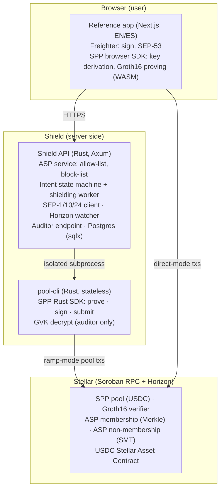
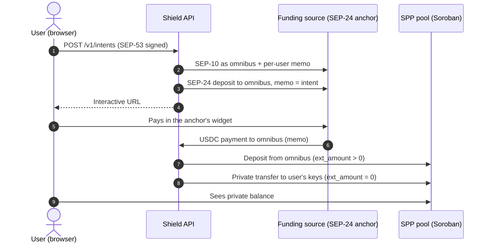
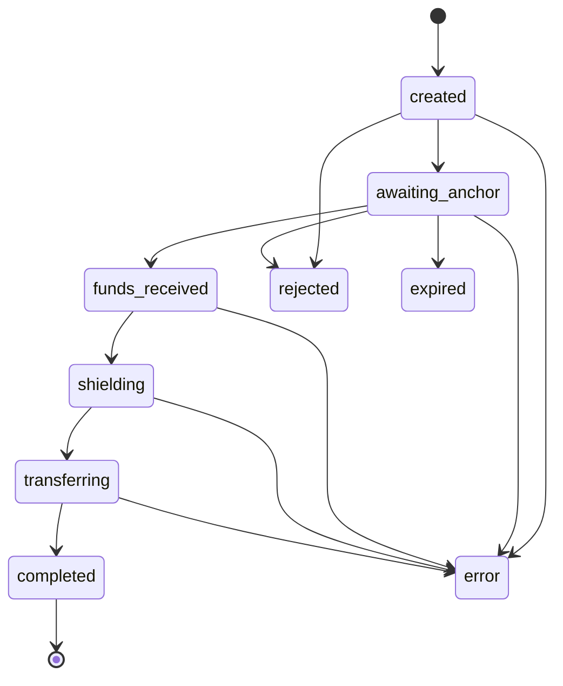

# Technical Architecture

**Shield Protocol: compliant private payments on Stellar** · Lendara · November 2026

Repository: [github.com/Lendara-Org/lendara-shield](https://github.com/Lendara-Org/lendara-shield) · Live on testnet: [lendara-shield.duckdns.org](https://lendara-shield.duckdns.org/en) · [Developer docs](https://lendara-shield.duckdns.org/en/docs) · [API reference](https://lendara-shield.duckdns.org/api-reference.html)


**Testnet only.** Stellar Private Payments is a developer preview with unaudited contracts. Do not use with real funds.


## 1. Summary

Lendara Shield gives wallets and anchors on Stellar compliant private payments through one API. Their users get private balances; the integrator controls who is eligible (the Association Set) and only an authorized auditor can see the details, without anyone building privacy infrastructure from scratch. Funding stays private too: money arriving from an external source can reach a private balance without the user's address appearing in the ramp's settlement transactions.

Shield is the reference implementation of the **Shield Protocol**: the operator layer a compliant privacy pool needs and that no single product should have to build alone. It runs on [Stellar Private Payments (SPP)](https://developers.stellar.org/docs/build/apps/privacy), the Privacy Pools implementation by Nethermind for Stellar (Circom circuits, Groth16 proofs verified in Soroban contracts), and adds no new cryptography.

A compliant SPP pool needs someone to maintain its Association Set (allow-list and block-list), safeguard the auditor's Global View Key, pay network fees, and move funds in and out without revealing who the user is. Shield is that shared layer, the same for every integrator. Integrators use one HTTP API (OpenAPI 3.1) and get:

* **Private balances:** deposits, private transfers and withdrawals, with proofs generated client-side.
* **An on-chain Association Set the integrator controls:** the integrator decides which of its users are eligible; Shield writes the allow-list and block-list.
* **Selective disclosure:** an authorized auditor can decrypt every note; nobody else can.
* **Private funding (ramp mode):** funds from an external source reach the user's private balance without exposing the user's address. The first supported source is a standard SEP-24 anchor; Shield Protocol level 2 ([Section 8](#8.-shield-protocol-level-2-specification-draft)) lets a source deposit straight into the pool.

Status: both modes run end to end on Stellar testnet ([Section 9](#9.-what-exists-today-testnet-verifiable)). The architecture below is the one deployed today; [Section 10](#10.-what-each-tranche-builds) marks what each tranche adds.

## 2. Design goals

1. **No new cryptography.** Shield builds on SPP's circuits and contracts instead of writing its own, and keeps all privacy guarantees inside SPP's model.
2. **Spending keys never leave the user.** Shield only ever receives public keys.
3. **Compliance by construction.** Every pool transaction needs a membership proof against the allow-list and a non-membership proof against the block-list. Every note is decryptable by the auditor.
4. **Money integrity over availability.** A payment is never made twice, even under RPC failures, retries or crashes.
5. **Separation of duties.** The operator, intake and auditor keys are three different keys with three different reaches.
6. **Standard interfaces.** SEP-1, SEP-10, SEP-24 and SEP-53 at the edges; OpenAPI as the contract for integrators.

## 3. Roles

| Role | Responsibility |
| --- | --- |
| **User** | Holds a Stellar wallet. Derives pool keys (note key, encryption key) in the browser; spending keys never leave it. |
| **Integrating app** | A wallet or an anchor that uses Shield. Individuals are its end users and reach Shield only through it. Decides which of its users are eligible under its own compliance policy and calls Shield's API. |
| **Shield operator (ASP)** | Administers the pool's allow-list and block-list contracts and pays the fees of those writes. |
| **Shield intake (omnibus)** | In ramp mode, receives external funds, deposits them into the pool and transfers them privately to the user. |
| **Auditor** | Holds the pool's Global View Key; decrypts every note. |
| **External funding source** | In ramp mode, the party that pays in (today a SEP-24 anchor). It is not modified. |

## 4. Components

Shield has three parts: a Rust API that runs the operator logic, an isolated prover CLI, and a reference web app where keys and proofs stay in the user's browser.

* **Shield API** (`apps/api`, Rust/Axum, Postgres): ASP, intents, SEP client, Horizon watcher, shielding worker and auditor. Hexagonal design: the chain, the anchor, the prover and the store are ports with real and fake adapters.
* **pool-cli** (`apps/pool-cli`, Rust): a stateless JSON CLI around the SPP Rust SDK for proving, signing and auditing. The API runs it as a subprocess with an empty environment plus only what each call needs. This keeps the prover isolated and avoids a SQLite linking conflict between the SPP SDK and `sqlx`.
* **Reference app** (`apps/web`, Next.js, EN/ES): registration, deposit (both modes), private wallet, audit view and developer docs. The SPP browser SDK derives keys and proves in the user's browser.
* **API contract** (`openapi.yaml`): source of truth; TypeScript types are generated from it (`packages/api-types`).

## 5. Stellar integration

| Stellar building block | How Shield uses it |
| --- | --- |
| **Soroban: SPP pool contract** | Deposits (`ext_amount > 0`), private transfers (`ext_amount = 0`) and withdrawals (`ext_amount < 0`) for a USDC pool. Deployed with SPP `sdk-v0.2.1`, policy `allowlist-blocklist` + `gvk-traceable`. |
| **Soroban: Groth16 verifier** | Verifies every pool transaction's proof on-chain (BN254 host functions). Proofs are generated client-side (direct mode) or by `pool-cli` (ramp mode). |
| **Soroban: ASP membership contract** | Merkle tree of approved keys. Shield's operator key inserts the leaf `H(note_public_key, membership_blinding)` when the integrating app approves a user. Append-only. |
| **Soroban: ASP non-membership contract** | Sparse Merkle tree used as the block-list. Every pool transaction proves the key is not in it. |
| **Stellar Asset Contract (USDC)** | The pool's asset. Ramp funds arrive as a classic payment and enter the pool through the SAC. |
| **SPP public key registry** | Deliberately **not used**: registering is a public transaction from the user's own address, which would reveal pool usage. Shield keeps the address ↔ keys mapping off-chain instead. |
| **SEP-53 (sign message)** | Every registration and every deposit request carries the account's signature (Freighter `signMessage`) over the exact payload, so nobody can attach keys to someone else's account or open deposits in their name. Deposit requests also carry a single-use `request_id` and a timestamp (≤ 5 min) against replay. |
| **SEP-1** | Discovers the funding anchor's endpoints from its `stellar.toml`; nothing is hardcoded. |
| **SEP-10** | Shield authenticates to the anchor as its omnibus account with an `id` memo per user, and fully verifies the challenge before signing. |
| **SEP-24** | Opens an interactive deposit whose destination is Shield's omnibus account with a random intent memo. Works with standard SEP-24 anchors without changes on the anchor's side. |
| **Horizon** | The watcher detects the anchor's payment by memo, asset code and issuer, and records the amount actually received. |
| **Soroban RPC** | Simulation, submission and the pool's event history needed for proving. |

## 6. Flows

### 6.1 Registration

1. The user's browser derives the pool keys from a wallet signature and computes the ASP leaf.
2. The browser sends `{stellar_account, note_public_key, encryption_public_key, asp_leaf}` plus a SEP-53 signature over exactly those fields to `POST /v1/onboarding`.
3. The integrating app's eligibility decision is applied (in the reference deployment, a simulated decision chosen in the UI).
4. On approval, the operator key inserts the leaf into the allow-list contract. The user's address appears nowhere on-chain.

### 6.2 Direct mode (user already holds USDC)

The user deposits from their own wallet, transfers privately and withdraws. Keys are derived and Groth16 proofs generated in the browser; Shield moves no money in this mode. Limitation today: the user's account is the transaction source, so it is visible as a pool user (amounts and recipients stay hidden). The relayer in Tranche 1 removes this for private transfers: it submits them as the transaction source and the pool's sender, so the user's account is neither. Direct deposits still come from the user's account, because the pool takes the tokens from the sender.

### 6.3 Ramp mode (external funding without exposure)

On-chain, an observer sees only "anchor → omnibus" and "omnibus → pool". A payment funds an intent only if the anchor reports that exact transaction (`stellar_transaction_id`). Memos are random (63 bits), so dust sent with someone's memo cannot hijack their deposit.

### 6.4 Intent state machine and idempotency

Once funds are in custody (`funds_received` onwards), an intent can only end `completed` or `error`.

Each pool transaction is proved, signed and **its hash persisted before submission**. On retry the worker checks the stored hash and resends the same envelope. It prepares a replacement only when the original can no longer land: its sequence number was consumed and the hash is still unknown after a grace period that covers RPC indexing lag.

The test suite runs against a fake chain that enforces Stellar's sequence rule, including ambiguous submits, dropped and refused transactions, indexing lag and a chaotic mix. Every test asserts exactly one deposit and one transfer.

### 6.5 Audit and blocking

* The auditor queries `GET /v1/audit/transactions`. Only the auditor's `pool-cli` process receives the Global View Key, which decrypts every note. The ASP maps note keys to accounts.
* Blocking inserts the user's key into the block-list. Unfunded intents of a blocked user end `rejected`. A funded one is stopped before its deposit, its transfer or a rebuilt transfer, and ends `error` with the funds in Shield's custody (the omnibus account, or Shield's own note after the deposit) for manual review. Nothing is sent to the frozen key.
* What happens next is a manual step today. Tranche 2 makes it a defined procedure: after review, the operator either resumes the intent (if the block is lifted), returns the funds to the anchor, or holds them. Every decision is written to an append-only audit log with who decided, when, why and the resulting transaction hashes.

All outcomes are listed in [Scenarios](scenarios.md).

## 7. Keys and security model

| Key / secret | Reach | Protection |
| --- | --- | --- |
| User spending keys | Only the user's browser | Never sent to Shield |
| Operator key (pool + ASP admin) | Allow-list and block-list writes | Server-side; must differ from the omnibus key (the API refuses to start otherwise); admin endpoints need a token |
| Omnibus key (intake) | Receives ramp funds, deposits, transfers | Separate key; `pool-cli` runs with an isolated environment |
| Global View Key (auditor) | Decrypts every note | Only passed to the auditor's `pool-cli` process; never to the worker, the browser or logs; audit endpoint behind a constant-time token check |

Logs carry intent ids and route templates, never "address + amount". The web app pins the circuit artifacts at build time and serves a Content-Security-Policy that limits scripts and network access to the app, the API and the RPC.

**Known limits** (full list in the [Threat model](threat-model.md)):

1. Amount and timing correlation between the anchor's payment and the pool deposit (mitigated in Tranche 3: batching, rounding, delays).
2. In direct mode the signer is visible (fixed by the relayer in Tranche 1).
3. In ramp mode the omnibus briefly holds the funds (removed by Shield Protocol level 2, Section 8).
4. Shield (as ASP) and the auditor are trusted parties: the compliance trade-off of a permissioned pool.
5. SPP is a developer preview with unaudited contracts; the testnet pool admin is a single key.
6. Proving needs the pool's full event history; the public RPC keeps about 7 days, so production needs an archival RPC or SPP's bootnode.
7. **Registration does not bind the ASP leaf to the user's key.** Shield receives `asp_leaf` but cannot check that it equals `H(note_public_key, membership_blinding)`, because the blinding stays in the browser. A user could register a leaf for a different key they control and keep using the pool after being blocked (the block-list holds the registered key, not the key behind the leaf). They could also register someone else's key and lend pool access to a person the integrator never approved. In both cases the auditor cannot map those notes to an account. Fixed in Tranche 1: the browser sends the blinding, and Shield recomputes the leaf and rejects any mismatch before inserting it. Shield already knows the key, so this reveals nothing new.

## 8. Shield Protocol level 2 (specification draft)

Level 2 lets a funding source deposit **directly** into the pool to the user's keys, removing the custody step of level 1. Level 1 (implemented) works with standard SEP-24 anchors without changes on their side; level 2 proposes a SEP-24 extension:

* **Discovery** in `stellar.toml`: `SHIELD_PROTOCOL_VERSION`, `SHIELD_POOL_CONTRACT`, `SHIELD_ASP_ENDPOINT`.
* **Capability** in SEP-24 `GET /info`: `features.shielded_deposit = true`.
* **Interactive deposit** with `destination_type: "shielded"` and `shielded_recipient: <note_public_key>:<encryption_public_key>` instead of `account`. The anchor must reject recipients whose leaf is not in the allow-list.
* **Settlement:** the distribution account calls the pool's deposit with an output note to the recipient and reports the pool transaction hash in `GET /transaction`.

Full draft: [Shield Protocol](shield-protocol.md). Tranche 2 delivers the complete specification, which any SEP-24 anchor can adopt, with Lendara's anchor as the first reference implementation.

## 9. What exists today (testnet, verifiable)

In the ramp run of 2026-10-26, the user's address appears 0 times across the anchor payment, the deposit and the transfer (checked on Horizon: transactions, operations and effects). The intent completed 60 s after creation with no manual step. Later checks are in [Testnet verification](testnet-verification.md). The transactions below belong to the first pool; it outlived the public RPC's 7-day history window and was redeployed on 2026-11-06, with SPP's bootnode now serving the older events.

| Evidence | Link |
| --- | --- |
| Ramp: allow-list insertion | [a09ac52f…f958](https://stellar.expert/explorer/testnet/tx/a09ac52f164725a64985871e58b5c2d577980154dfd3a82c23927c9af187f958) |
| Ramp: anchor → omnibus (memo) | [bad64913…a358](https://stellar.expert/explorer/testnet/tx/bad649134d3ca5e796ba29dc8aebcbde923d573aa532e07af0faf2e1f105a358) |
| Ramp: pool deposit (`ext_amount > 0`) | [57756b31…26e1](https://stellar.expert/explorer/testnet/tx/57756b312631f526779dcbbf555833b72e95f0f3c0be3f153f0fc33d986026e1) |
| Ramp: private transfer (`ext_amount = 0`) | [86edced9…6420](https://stellar.expert/explorer/testnet/tx/86edced9f47e3f8582272b74ddcc998af18fd22e5b6cdaf76f6e399dad046420) |
| Direct: private transfer from the browser | [84c898a0…ca41](https://stellar.expert/explorer/testnet/tx/84c898a0ce46c0005a1eb476a5e71b3e500c53949b33a96978bc3a62f5ceca41) |
| Pool of that run (2026-10-26, ledger 5,395,126) | [CDD66GL3…C7OF](https://stellar.expert/explorer/testnet/contract/CDD66GL3HT5JLRIB5BHAV36XFSEAGRXMGRJJ4VK747ODBXEJ77YAC7OF) |
| Current pool (USDC, redeployed 2026-11-06, ledger 5,591,375) | [CAB6FI43…KR4](https://stellar.expert/explorer/testnet/contract/CAB6FI43BVMPMAXYCLVZ7R5DYQY3IUJF3G7JMSBEXJHWO7LEUE3H4KR4) |
| Current ASP allow-list | [CCCFDS2I…CHVG](https://stellar.expert/explorer/testnet/contract/CCCFDS2IABWNR7VEFH5F3OUGNBMNPVMD5UOA7V6V4ZCBTM3UEMRYCHVG) |
| Current ASP block-list | [CAO3DGTQ…B53C](https://stellar.expert/explorer/testnet/contract/CAO3DGTQTVZ2A7XVKKZDHOR7CTTPOYV4U3YLK5UDCUSQBUE6RBEVB53C) |

## 10. What each tranche builds

| Tranche | Builds on the architecture above |
| --- | --- |
| **1 — Developer-ready testnet** | ASP leaf bound to the registered key (closes known limit 7) · relayer with its own transaction source and pool-call sender (direct-mode users no longer visible as source or signer of private transfers) · project API keys, scoped permissions and sessions, including the integrator's eligibility decision through its key · TypeScript SDK generated from `openapi.yaml` |
| **2 — Production readiness** | Shield Protocol level 2: complete specification that any SEP-24 anchor can adopt, with Lendara's anchor as the first reference implementation (direct deposits into the pool, no custody step) · operator and omnibus keys in a KMS/HSM with rotation; the view key stored encrypted with access logs (its public half is fixed per pool) · per-note selective disclosure for users and a role-based auditor portal with access logs · resolution of blocked users' funds (resume, return to the anchor or hold) with an audit log · integration with a second funding source · threat model (STRIDE-style) and monitoring plan for the production deployment |
| **3 — Mainnet** | Mainnet deployment with archival RPC, monitoring and alerts; ramp mode on level 2 only, so Shield holds no user funds on mainnet · anonymity-set hardening (batching, rounding, delays) · first third-party wallet integration |

See the [Roadmap](roadmap.md) for what is already done.

## 11. How Shield differs from existing Stellar privacy projects

Shield differs in two places. It operates SPP as a shared compliance layer that any product integrates through one API, and it keeps funding private: money entering from an external source lands as a private balance without the user's address appearing in the ramp's settlement transactions. Comparison based on each project's public SCF submission or announcement:

| Project | Approach | Shield's difference |
| --- | --- | --- |
| [Arcane](https://communityfund.stellar.org/project/rec8kVwGfeiRTC3fq) (SCF #42) | Its own private transaction engine plus a compliance portal and SDK for institutions | Shield adds no new engine: it is the operator layer on top of SPP, the pool implementation featured in Stellar's docs |
| [Moonlight](https://communityfund.stellar.org/submissions/recNF9qwGZwrMlDfu) (SCF #37) | Its own UTXO-based privacy channels operated by Trusted Privacy Providers | Shield uses SPP's pool and ASP model and contributes a SEP-24-compatible funding path (level 1 today, level 2 spec) |
| [LumenShade](https://communityfund.stellar.org/dashboard/projects/rec3veejDmuuYhhnP) (SCF #37) | A privacy pools protocol with its own circuits | Same model as SPP; Shield does not compete at the circuit layer, it operates and integrates it |
| [Private & compliant payments on Stellar](https://communityfund.stellar.org/dashboard/submissions/recJbAw5nnUU1ZUmb) (SCF #40) | Confidential amounts and balances with selective disclosure, starting from an off-chain co-processor | Shield hides counterparties, not only amounts, and keeps proving and verification on Stellar through SPP |
| [Zarf](https://communityfund.stellar.org/submissions/rec81hKwglu2sUT1N) (SCF #42) | Private token distribution to email addresses using ZK proofs over login tokens | A different use case (distributions); Shield covers ongoing private payments and private funding |
| [Confidential Tokens](https://stellar.org/blog/developers/developer-preview-confidential-tokens-on-stellar) (OpenZeppelin, SDF developer preview) | A wrapper over SEP-41 tokens that hides balances and amounts; addresses stay visible | Complementary: Confidential Tokens serve known-counterparty flows where the amount is private; Shield serves flows where the counterparties are private. After this award, Shield's compliance layer extends to Confidential Tokens (see the [Roadmap](roadmap.md)) |

## 12. Dependencies and risks

* **SPP maturity.** SPP is a developer preview with unaudited contracts. Mainnet (Tranche 3) depends on SPP's audit and mainnet release; we track Nethermind's releases and will coordinate the final tranche timing with the SCF team if needed.
* **History availability.** Proving needs the pool's full event history: production requires an archival RPC or SPP's bootnode.
* **Asset issuer powers.** The testnet USDC issuer has neither `AUTH_REVOCABLE` nor `AUTH_CLAWBACK_ENABLED` today, but it is not `AUTH_IMMUTABLE`: it could enable them later and freeze the pool's balance. For a compliant pool this is an accepted risk, consistent with its compliance model; Shield documents it for integrators.
* **Trusted operator.** Shield and the auditor are trusted parties by design; splitting these roles across independent parties is future work beyond this award.
