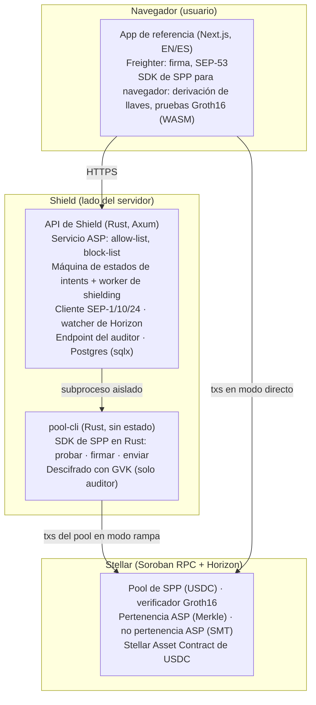
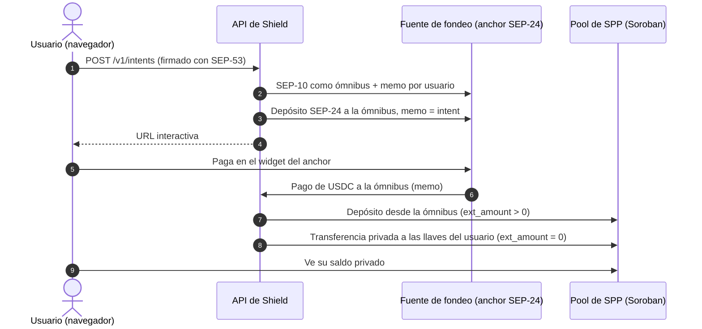
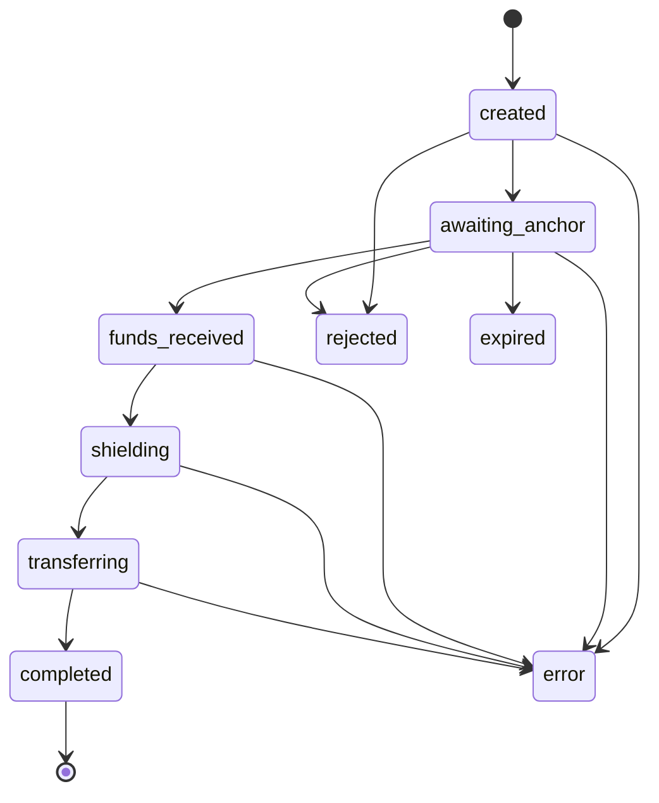

# Arquitectura técnica

**Shield Protocol: pagos privados con cumplimiento en Stellar** · Lendara · noviembre de 2026

Repositorio: [github.com/Lendara-Org/lendara-shield](https://github.com/Lendara-Org/lendara-shield) · En vivo en testnet: [lendara-shield.duckdns.org](https://lendara-shield.duckdns.org/es) · [Documentación para developers](https://lendara-shield.duckdns.org/es/docs) · [Referencia de la API](https://lendara-shield.duckdns.org/api-reference.html)


**Solo testnet.** Stellar Private Payments es una developer preview con contratos sin auditar. No lo uses con fondos reales.


## 1. Resumen

Lendara Shield le da a cualquier producto en Stellar pagos privados con cumplimiento a través de una sola API. Wallets, anchors, apps de pago y usuarios individuales obtienen saldos privados, un Association Set que ellos controlan y divulgación solo para el auditor, sin construir ellos mismos la infraestructura de privacidad. El fondeo también queda privado: el dinero que llega desde una fuente externa puede llegar a un saldo privado sin que la dirección del usuario aparezca nunca on-chain.

Shield es la implementación de referencia del **Shield Protocol**: la capa de operador que necesita un privacy pool con cumplimiento y que ningún producto debería tener que construir solo. Corre sobre [Stellar Private Payments (SPP)](https://developers.stellar.org/docs/build/apps/privacy), la implementación de Privacy Pools de Nethermind para Stellar (circuitos Circom, pruebas Groth16 verificadas en contratos Soroban), y no agrega criptografía nueva.

Un pool de SPP con cumplimiento necesita a alguien que mantenga su Association Set (allow-list y block-list), resguarde la Global View Key del auditor, pague las comisiones de la red y mueva fondos hacia dentro y hacia fuera sin revelar quién es el usuario. Shield es esa capa compartida, igual para cada integrador. Los integradores usan una sola API HTTP (OpenAPI 3.1) y obtienen:

* **Saldos privados:** depósitos, transferencias privadas y retiros, con pruebas generadas del lado del cliente.
* **Un Association Set on-chain que controla el integrador:** el integrador decide cuáles de sus usuarios son elegibles; Shield escribe la allow-list y la block-list.
* **Divulgación selectiva:** un auditor autorizado puede descifrar cada nota; nadie más puede.
* **Fondeo privado (modo rampa):** los fondos de una fuente externa llegan al saldo privado del usuario sin exponer su dirección. La primera fuente soportada es cualquier anchor SEP-24; el nivel 2 del Shield Protocol ([sección 8](#8.-shield-protocol-nivel-2-borrador)) permite que una fuente deposite directo en el pool.

Estado: ambos modos corren de punta a punta en Stellar testnet ([sección 9](#9.-lo-que-existe-hoy-testnet-verificable)). La arquitectura de abajo es la que está desplegada hoy; la [sección 10](#10.-lo-que-construye-cada-tramo) marca lo que agrega cada tramo.

## 2. Objetivos de diseño

1. **Sin criptografía nueva.** Shield se apoya en los circuitos y contratos de SPP en vez de escribir los suyos, y mantiene todas las garantías de privacidad dentro del modelo de SPP.
2. **Las llaves de gasto nunca salen del usuario.** Shield solo recibe llaves públicas.
3. **Cumplimiento por construcción.** Cada transacción del pool necesita una prueba de pertenencia a la allow-list y una prueba de no pertenencia a la block-list. El auditor puede descifrar cada nota.
4. **Integridad del dinero por sobre la disponibilidad.** Un pago nunca se hace dos veces, ni siquiera ante fallas del RPC, reintentos o caídas.
5. **Separación de funciones.** Las llaves de operador, de intake y del auditor son tres llaves distintas con tres alcances distintos.
6. **Interfaces estándar.** SEP-1, SEP-10, SEP-24 y SEP-53 en los bordes; OpenAPI como contrato para los integradores.

## 3. Roles

| Rol | Responsabilidad |
| --- | --- |
| **Usuario** | Tiene una wallet de Stellar. Deriva las llaves del pool (llave de nota, llave de cifrado) en el navegador; las llaves de gasto nunca salen de ahí. |
| **App integradora** | Cualquier producto que usa Shield: una wallet, un anchor, una app de pagos o el cliente propio de una persona. Decide cuáles de sus usuarios son elegibles según su propia política de cumplimiento y llama a la API de Shield. |
| **Operador de Shield (ASP)** | Administra los contratos de allow-list y block-list del pool y paga las comisiones de esas escrituras. |
| **Intake de Shield (ómnibus)** | En modo rampa, recibe los fondos externos, los deposita en el pool y los transfiere en privado al usuario. |
| **Auditor** | Tiene la Global View Key del pool; descifra cada nota. |
| **Fuente de fondeo externa** | En modo rampa, la parte que paga (hoy un anchor SEP-24). No se modifica. |

## 4. Componentes

Shield tiene tres partes: una API en Rust que corre la lógica del operador, un CLI de pruebas aislado y una app web de referencia donde las llaves y las pruebas se quedan en el navegador del usuario.

* **API de Shield** (`apps/api`, Rust/Axum, Postgres): ASP, intents, cliente SEP, watcher de Horizon, worker de shielding y auditor. Diseño hexagonal: la cadena, el anchor, el prover y el almacenamiento son puertos con adaptadores reales y falsos.
* **pool-cli** (`apps/pool-cli`, Rust): un CLI JSON sin estado alrededor del SDK de SPP en Rust para probar, firmar y auditar. La API lo corre como subproceso con un entorno vacío más solo lo que necesita cada llamada. Así el prover queda aislado y se evita un conflicto de enlazado de SQLite entre el SDK de SPP y `sqlx`.
* **App de referencia** (`apps/web`, Next.js, EN/ES): registro, depósito (ambos modos), wallet privada, vista de auditoría y documentación para developers. El SDK de SPP para navegador deriva las llaves y genera las pruebas en el navegador del usuario.
* **Contrato de la API** (`openapi.yaml`): fuente de verdad; los tipos de TypeScript se generan desde ahí (`packages/api-types`).

## 5. Integración con Stellar

| Pieza de Stellar | Cómo la usa Shield |
| --- | --- |
| **Soroban: contrato del pool de SPP** | Depósitos (`ext_amount > 0`), transferencias privadas (`ext_amount = 0`) y retiros (`ext_amount < 0`) para un pool de USDC. Desplegado con SPP `sdk-v0.2.1`, política `allowlist-blocklist` + `gvk-traceable`. |
| **Soroban: verificador Groth16** | Verifica on-chain la prueba de cada transacción del pool (funciones host BN254). Las pruebas se generan del lado del cliente (modo directo) o con `pool-cli` (modo rampa). |
| **Soroban: contrato de pertenencia del ASP** | Árbol de Merkle de llaves aprobadas. La llave de operador de Shield inserta la hoja `H(note_public_key, membership_blinding)` cuando la app integradora aprueba a un usuario. Solo admite agregar. |
| **Soroban: contrato de no pertenencia del ASP** | Sparse Merkle tree usado como block-list. Cada transacción del pool prueba que la llave no está en él. |
| **Stellar Asset Contract (USDC)** | El activo del pool. Los fondos de la rampa llegan como un pago clásico y entran al pool a través del SAC. |
| **Registro de llaves públicas de SPP** | **No se usa** a propósito: registrarse es una transacción pública desde la dirección propia del usuario, lo que revelaría que usa el pool. En cambio, Shield guarda off-chain la relación dirección ↔ llaves. |
| **SEP-53 (firmar mensaje)** | Cada registro y cada solicitud de depósito lleva la firma de la cuenta (`signMessage` de Freighter) sobre el payload exacto, así que nadie puede asociar llaves a la cuenta de otra persona ni abrir depósitos a su nombre. Las solicitudes de depósito también llevan un `request_id` de un solo uso y un timestamp (≤ 5 min) contra el replay. |
| **SEP-1** | Descubre los endpoints del anchor de fondeo desde su `stellar.toml`; nada está hardcodeado. |
| **SEP-10** | Shield se autentica ante el anchor como su cuenta ómnibus con un memo `id` por usuario, y verifica el challenge por completo antes de firmar. |
| **SEP-24** | Abre un depósito interactivo cuyo destino es la cuenta ómnibus de Shield con un memo de intent aleatorio. Funciona con cualquier anchor SEP-24 sin cambios del lado del anchor. |
| **Horizon** | El watcher detecta el pago del anchor por memo, código del activo e issuer, y registra el monto recibido realmente. |
| **Soroban RPC** | Simulación, envío y el historial de eventos del pool necesario para generar pruebas. |

## 6. Flujos

### 6.1 Registro

1. El navegador del usuario deriva las llaves del pool a partir de una firma de la wallet y calcula la hoja del ASP.
2. El navegador envía `{stellar_account, note_public_key, encryption_public_key, asp_leaf}` más una firma SEP-53 sobre exactamente esos campos a `POST /v1/onboarding`.
3. Se aplica la decisión de elegibilidad de la app integradora (en el despliegue de referencia, una decisión simulada que se elige en la UI).
4. Si se aprueba, la llave de operador inserta la hoja en el contrato de la allow-list. La dirección del usuario no aparece en ningún lugar on-chain.

### 6.2 Modo directo (el usuario ya tiene USDC)

El usuario deposita desde su propia wallet, transfiere en privado y retira. Las llaves se derivan y las pruebas Groth16 se generan en el navegador; en este modo Shield no mueve dinero. Limitación actual: la cuenta del usuario es la fuente de la transacción, así que es visible como usuaria del pool (los montos y los destinatarios siguen ocultos). El relayer con fee-bump del tramo 1 elimina esto.

### 6.3 Modo rampa (fondeo externo sin exposición)

On-chain, un observador solo ve "anchor → ómnibus" y "ómnibus → pool". Un pago fondea un intent solo si el anchor reporta esa misma transacción (`stellar_transaction_id`). Los memos son aleatorios (63 bits), así que el polvo enviado con el memo de otra persona no puede secuestrar su depósito.

### 6.4 Máquina de estados de los intents e idempotencia

Una vez que los fondos están en custodia (de `funds_received` en adelante), un intent solo puede terminar en `completed` o `error`.

Cada transacción del pool se prueba, se firma y **su hash se guarda antes de enviarla**. En un reintento, el worker revisa el hash guardado y reenvía el mismo sobre. Prepara un reemplazo solo cuando el original ya no puede entrar: su número de secuencia se consumió y el hash sigue sin aparecer después de un período de gracia que cubre el retraso de indexación del RPC.

La suite de tests corre contra una cadena falsa que aplica la regla de secuencia de Stellar, incluidos envíos ambiguos, transacciones descartadas y rechazadas, retraso de indexación y una mezcla caótica. Cada test verifica exactamente un depósito y una transferencia.

### 6.5 Auditoría y bloqueo

* El auditor consulta `GET /v1/audit/transactions`. Solo el proceso `pool-cli` del auditor recibe la Global View Key, que descifra cada nota. El ASP relaciona las llaves de nota con las cuentas.
* Bloquear inserta la llave del usuario en la block-list. Los intents sin fondear de un usuario bloqueado terminan en `rejected`. Uno fondeado se detiene antes de su depósito, de su transferencia o de una transferencia rearmada, y termina en `error` con los fondos en custodia de Shield (la cuenta ómnibus, o la nota propia de Shield después del depósito) para revisión manual. No se envía nada a la llave congelada.
* Hoy el paso siguiente es manual. El tramo 2 lo convierte en un procedimiento definido: después de la revisión, el operador reanuda el intent (si se levanta el bloqueo), devuelve los fondos al anchor o los retiene. Cada decisión queda en un registro de auditoría de solo agregar, con quién decidió, cuándo, por qué y los hashes de las transacciones resultantes.

Todos los resultados están en [Escenarios](scenarios.md).

## 7. Llaves y modelo de seguridad

| Llave / secreto | Alcance | Protección |
| --- | --- | --- |
| Llaves de gasto del usuario | Solo el navegador del usuario | Nunca se envían a Shield |
| Llave de operador (admin del pool + ASP) | Escrituras en la allow-list y la block-list | Del lado del servidor; debe ser distinta de la llave ómnibus (si no, la API se niega a arrancar); los endpoints de admin requieren un token |
| Llave ómnibus (intake) | Recibe los fondos de la rampa, deposita, transfiere | Llave separada; `pool-cli` corre con un entorno aislado |
| Global View Key (auditor) | Descifra cada nota | Solo se pasa al proceso `pool-cli` del auditor; nunca al worker, al navegador ni a los logs; endpoint de auditoría detrás de una verificación de token en tiempo constante |

Los logs llevan ids de intent y plantillas de ruta, nunca "dirección + monto". La app web fija los artefactos de los circuitos en el build y sirve una Content-Security-Policy que limita los scripts y el acceso a la red a la app, la API y el RPC.

**Límites conocidos** (lista completa en el [Modelo de amenazas](threat-model.md)):

1. Correlación por monto y hora entre el pago del anchor y el depósito en el pool (se mitiga en el tramo 3: agrupación, redondeo, demoras).
2. En modo directo el firmante es visible (lo resuelve el relayer en el tramo 1).
3. En modo rampa la ómnibus tiene los fondos por un momento (lo elimina el nivel 2 del Shield Protocol, sección 8).
4. Shield (como ASP) y el auditor son partes de confianza: la concesión de cumplimiento de un pool con permisos.
5. SPP es una developer preview con contratos sin auditar; el admin del pool en testnet es una sola llave.
6. Generar pruebas requiere el historial completo de eventos del pool; el RPC público guarda unos 7 días, así que producción necesita un RPC de archivo o el bootnode de SPP.
7. **El registro no amarra la hoja del ASP a la llave del usuario.** Shield recibe `asp_leaf`, pero no puede comprobar que sea igual a `H(note_public_key, membership_blinding)`, porque el blinding se queda en el navegador. Un usuario podría registrar la hoja de otra llave que controla y seguir usando el pool después de ser bloqueado (la block-list tiene la llave registrada, no la que está detrás de la hoja). También podría registrar la llave de otra persona y prestarle acceso al pool sin que haya pasado el KYC. En los dos casos el auditor no puede relacionar esas notas con una cuenta. Se corrige en el tramo 1: el navegador envía el blinding, y Shield recalcula la hoja y rechaza cualquier diferencia antes de insertarla. Shield ya conoce la llave, así que esto no revela nada nuevo.

## 8. Shield Protocol nivel 2 (borrador)

El nivel 2 permite que una fuente de fondeo deposite **directo** en el pool a las llaves del usuario, lo que elimina el paso de custodia del nivel 1. El nivel 1 (implementado) funciona con cualquier anchor SEP-24 sin cambios; el nivel 2 propone una extensión de SEP-24:

* **Descubrimiento** en `stellar.toml`: `SHIELD_PROTOCOL_VERSION`, `SHIELD_POOL_CONTRACT`, `SHIELD_ASP_ENDPOINT`.
* **Capacidad** en `GET /info` de SEP-24: `features.shielded_deposit = true`.
* **Depósito interactivo** con `destination_type: "shielded"` y `shielded_recipient: <note_public_key>:<encryption_public_key>` en vez de `account`. El anchor debe rechazar los destinatarios cuya hoja no está en la allow-list.
* **Liquidación:** la cuenta de distribución llama al depósito del pool con una nota de salida para el destinatario y reporta el hash de la transacción del pool en `GET /transaction`.

Borrador completo: [Shield Protocol](shield-protocol.md). El tramo 2 entrega la especificación completa y una implementación de referencia en el anchor SEP-24 de Lendara.

## 9. Lo que existe hoy (testnet, verificable)

En la corrida de rampa del 2026-10-26, la dirección del usuario aparece 0 veces entre el pago del anchor, el depósito y la transferencia (verificado en Horizon: transacciones, operaciones y efectos). El intent se completó 60 s después de crearse, sin ningún paso manual. Las verificaciones posteriores están en [Verificación en testnet](testnet-verification.md).

| Evidencia | Enlace |
| --- | --- |
| Rampa: inserción en la allow-list | [a09ac52f…f958](https://stellar.expert/explorer/testnet/tx/a09ac52f164725a64985871e58b5c2d577980154dfd3a82c23927c9af187f958) |
| Rampa: anchor → ómnibus (memo) | [bad64913…a358](https://stellar.expert/explorer/testnet/tx/bad649134d3ca5e796ba29dc8aebcbde923d573aa532e07af0faf2e1f105a358) |
| Rampa: depósito en el pool (`ext_amount > 0`) | [57756b31…26e1](https://stellar.expert/explorer/testnet/tx/57756b312631f526779dcbbf555833b72e95f0f3c0be3f153f0fc33d986026e1) |
| Rampa: transferencia privada (`ext_amount = 0`) | [86edced9…6420](https://stellar.expert/explorer/testnet/tx/86edced9f47e3f8582272b74ddcc998af18fd22e5b6cdaf76f6e399dad046420) |
| Directo: transferencia privada desde el navegador | [84c898a0…ca41](https://stellar.expert/explorer/testnet/tx/84c898a0ce46c0005a1eb476a5e71b3e500c53949b33a96978bc3a62f5ceca41) |
| Contrato del pool (USDC) | [CDD66GL3…C7OF](https://stellar.expert/explorer/testnet/contract/CDD66GL3HT5JLRIB5BHAV36XFSEAGRXMGRJJ4VK747ODBXEJ77YAC7OF) |
| Allow-list del ASP | [CCETAQAR…26GB](https://stellar.expert/explorer/testnet/contract/CCETAQARCUMNMCLJKQM6UNY2QJDOJZYGI54MXA3FMPJY4VJDMN2L26GB) |
| Block-list del ASP | [CCWU7V5H…NLKT](https://stellar.expert/explorer/testnet/contract/CCWU7V5HXV6NKPJ3UEZMTGFWK3V35YO42AQTPSXPN2GSDK3RXLICNLKT) |

## 10. Lo que construye cada tramo

| Tramo | Construye sobre la arquitectura de arriba |
| --- | --- |
| **1 — Testnet lista para developers** | Hoja del ASP amarrada a la llave registrada (cierra el límite conocido 7) · relayer con fee-bump (los usuarios del modo directo ya no son visibles como firmantes) · API keys por proyecto, permisos acotados y sesiones, incluida la decisión de elegibilidad del integrador a través de su key · SDK de TypeScript generado desde `openapi.yaml` |
| **2 — Preparación para producción** | Shield Protocol nivel 2: especificación completa e implementación de referencia en el anchor SEP-24 de Lendara (depósitos directos al pool, sin paso de custodia) · llaves de operador, ómnibus y de vista en un KMS/HSM con rotación · divulgación selectiva por nota para los usuarios y un portal de auditor basado en roles con registros de acceso · resolución de los fondos de usuarios bloqueados (reanudar, devolver al anchor o retener) con registro de auditoría · integración con una segunda fuente de fondeo |
| **3 — Mainnet** | Despliegue en mainnet con RPC de archivo, monitoreo y alertas · refuerzo del anonymity set (agrupación, redondeo, demoras) · primera integración con una wallet de terceros |

Consulta el [Roadmap](roadmap.md) para ver lo que ya está hecho.

## 11. En qué se diferencia Shield de los proyectos de privacidad existentes en Stellar

Shield se diferencia en dos puntos. Opera SPP como una capa de cumplimiento compartida que cualquier producto integra a través de una sola API, y mantiene privado el fondeo: el dinero que entra desde una fuente externa llega como saldo privado sin que la dirección del usuario quede nunca on-chain. Comparación basada en la postulación pública al SCF o el anuncio de cada proyecto:

| Proyecto | Enfoque | Diferencia de Shield |
| --- | --- | --- |
| [Arcane](https://communityfund.stellar.org/project/rec8kVwGfeiRTC3fq) (SCF #42) | Su propio motor de transacciones privadas, más un portal de cumplimiento y un SDK para instituciones | Shield no agrega un motor nuevo: es la capa de operador sobre SPP, la implementación de pool que aparece en la documentación de Stellar |
| [Moonlight](https://communityfund.stellar.org/submissions/recNF9qwGZwrMlDfu) (SCF #37) | Sus propios canales de privacidad basados en UTXO, operados por Trusted Privacy Providers | Shield usa el pool y el modelo de ASP de SPP y aporta un camino de fondeo compatible con SEP-24 (nivel 1 hoy, spec del nivel 2) |
| [LumenShade](https://communityfund.stellar.org/dashboard/projects/rec3veejDmuuYhhnP) (SCF #37) | Un protocolo de privacy pools con sus propios circuitos | El mismo modelo que SPP; Shield no compite en la capa de circuitos, la opera y la integra |
| [Private & compliant payments on Stellar](https://communityfund.stellar.org/dashboard/submissions/recJbAw5nnUU1ZUmb) (SCF #40) | Montos y saldos confidenciales con divulgación selectiva, partiendo de un coprocesador off-chain | Shield oculta las contrapartes, no solo los montos, y mantiene la generación y la verificación de pruebas en Stellar a través de SPP |
| [Zarf](https://communityfund.stellar.org/submissions/rec81hKwglu2sUT1N) (SCF #42) | Distribución privada de tokens a direcciones de email con pruebas ZK sobre tokens de inicio de sesión | Un caso de uso distinto (distribuciones); Shield cubre pagos privados continuos y fondeo privado |
| [Confidential Tokens](https://stellar.org/blog/developers/developer-preview-confidential-tokens-on-stellar) (OpenZeppelin, developer preview de la SDF) | Un wrapper sobre tokens SEP-41 que oculta saldos y montos; las direcciones siguen visibles | Complementario: Confidential Tokens sirve flujos con contrapartes conocidas donde el monto es privado; Shield sirve flujos donde las contrapartes son privadas |

## 12. Dependencias y riesgos

* **Madurez de SPP.** SPP es una developer preview con contratos sin auditar. Mainnet (tramo 3) depende de la auditoría y el lanzamiento en mainnet de SPP; seguimos los releases de Nethermind y, si hace falta, coordinaremos con el equipo del SCF el calendario del último tramo.
* **Disponibilidad del historial.** Generar pruebas requiere el historial completo de eventos del pool: producción necesita un RPC de archivo o el bootnode de SPP.
* **Poderes del issuer del activo.** Hoy el issuer del USDC de testnet no tiene ni `AUTH_REVOCABLE` ni `AUTH_CLAWBACK_ENABLED`, pero no es `AUTH_IMMUTABLE`: podría activarlos más adelante y congelar el saldo del pool. Para un pool con cumplimiento es un riesgo aceptado, coherente con su modelo de cumplimiento; Shield lo documenta para los integradores.
* **Operador de confianza.** Shield y el auditor son partes de confianza por diseño; repartir estos roles entre partes independientes es trabajo futuro que va más allá de este award.
